# SplitEase

[](https://nextjs.org)
[](https://www.typescriptlang.org)
[](https://www.mongodb.com)
[](https://tailwindcss.com)
[](LICENSE)

**Split expenses with friends and groups, track who owes whom, and settle up with the fewest payments.** A full-stack Splitwise-style app built with Next.js 16, MongoDB and Google sign-in.

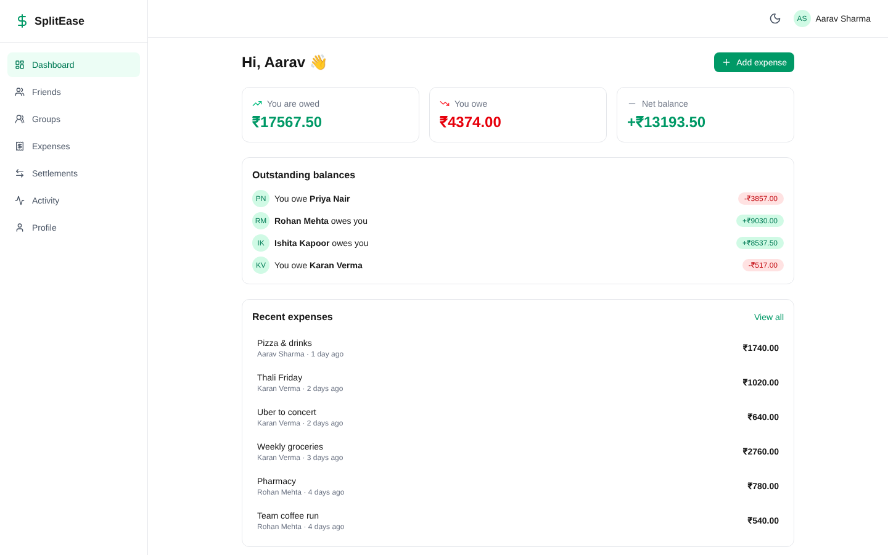

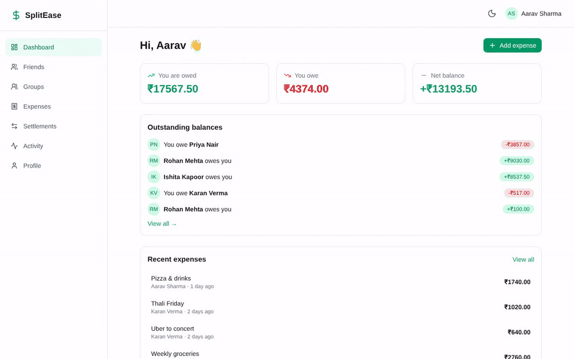

## Why I built this

Shared costs (trips, flat bills, team lunches) usually end in spreadsheets and awkward reminders. I wanted to build the whole thing end to end: correct money math, a real auth flow, a data model that handles groups and settlements, and a UI that works on a phone. It is also a playground for patterns I care about: integer-cent money, pure and tested domain logic, and optimistic UI.

## Features

- **Four split types** - equal, unequal, percentage and shares; leftover cents are assigned deterministically so splits always sum to the total
- **Groups** - trips, home, couple, work; admin/member roles
- **Friends** - add by email, accept or decline requests, see per-friend balances
- **Debt simplification** - greedy min-cash-flow reduces the number of payments needed to settle a group
- **Settlements** - record payments and keep a history
- **Activity feed** - every change logged, filterable, with CSV export
- **Google OAuth** with database-backed sessions (30 days)
- **Responsive and installable** - mobile bottom nav, PWA manifest, light/dark theme
- **Optimistic UI** with TanStack Query and rollback on error

## Screenshots

| | |
|---|---|
| 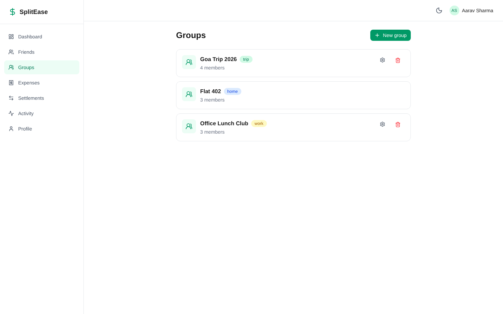<br>Groups | 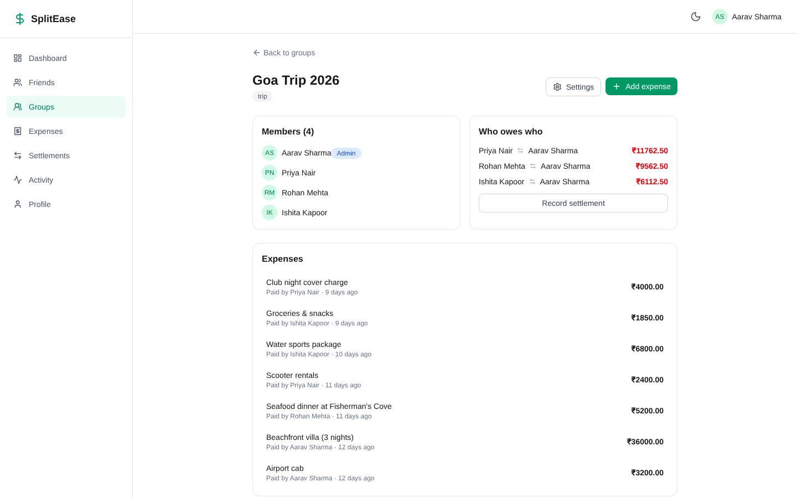<br>Group detail and who owes who |
| 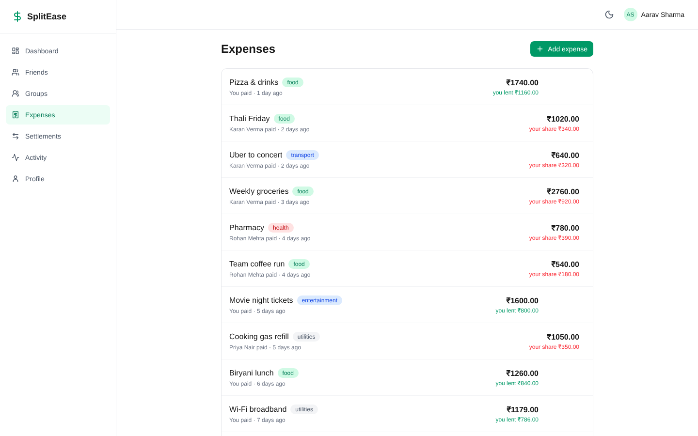<br>Expenses | 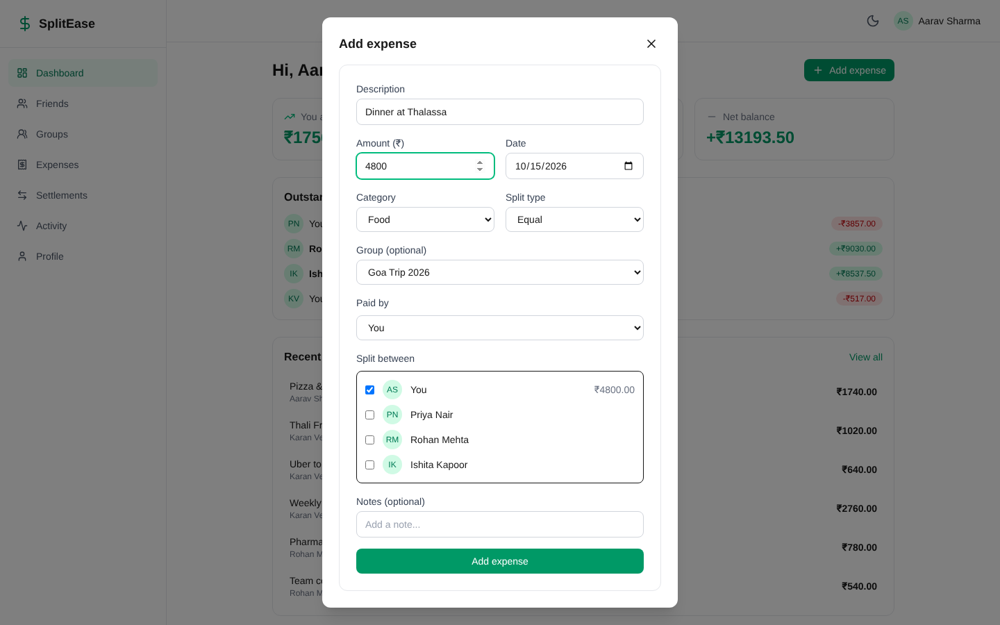<br>Add expense with split |
| 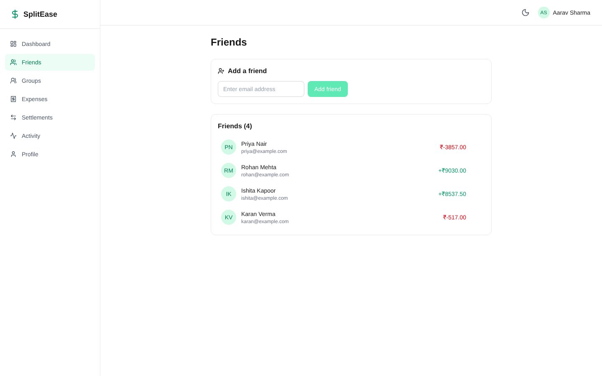<br>Friends | 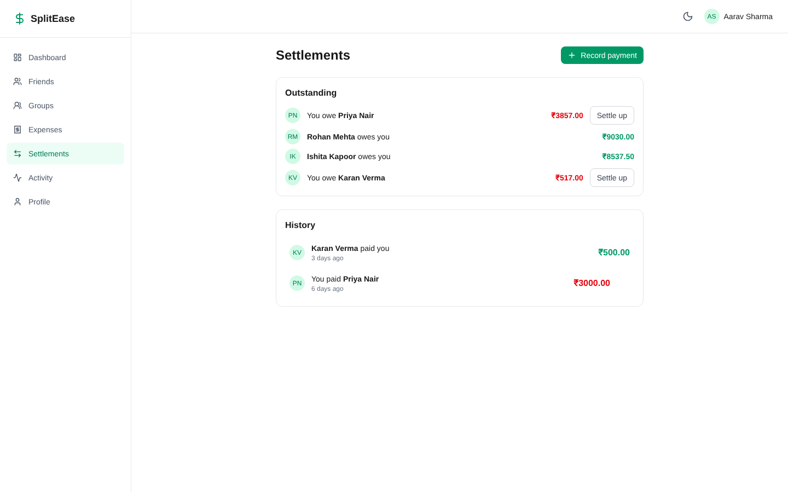<br>Settlements |
| 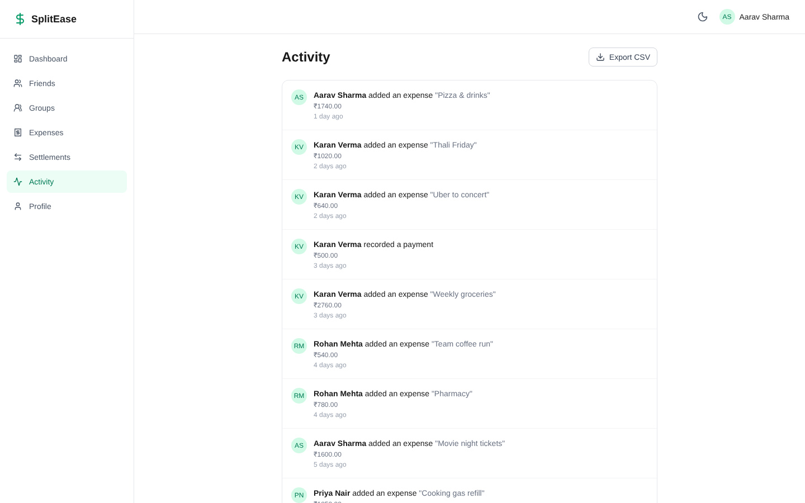<br>Activity feed | 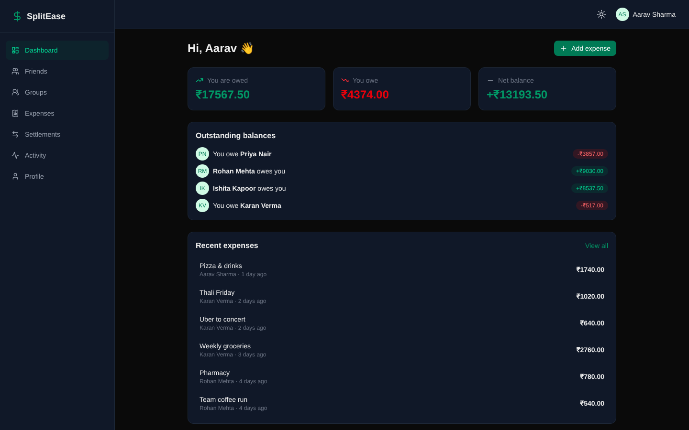<br>Dark mode |

<p align="center">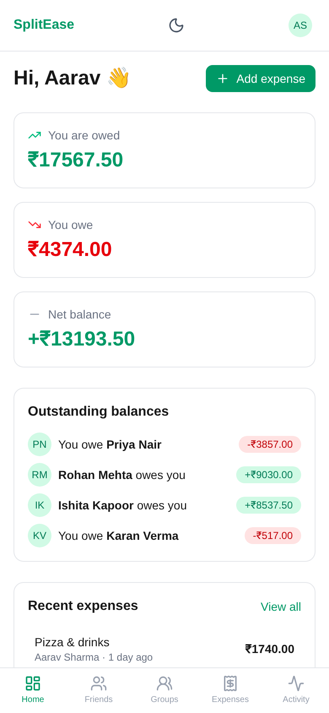</p>

*Screenshots use fictional demo data.*

## Architecture

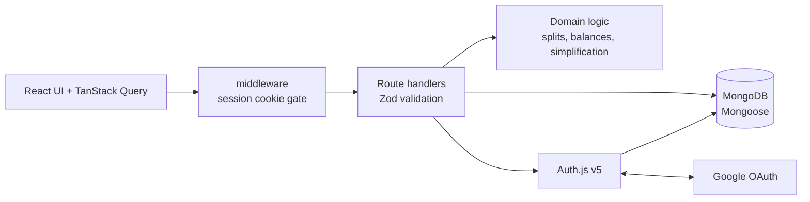

Sequence diagrams, the data model (ER) and design decisions: [docs/ARCHITECTURE.md](docs/ARCHITECTURE.md).

## Tech stack

| Area | Choice |
|------|--------|
| Framework | Next.js 16 (App Router), React 19, TypeScript |
| Data | MongoDB, Mongoose 9 |
| Auth | Auth.js (next-auth v5), Google provider, MongoDB adapter |
| UI | Tailwind CSS 4, lucide-react |
| Client data | TanStack Query 5, React Hook Form, Zod 4 |
| Tests | Jest, ts-jest, mongodb-memory-server |

## Quick start

Requires Node 20+, a MongoDB instance and Google OAuth credentials.

```bash
git clone https://github.com/ashish979/expense-manager.git
cd expense-manager
npm ci
cp .env.local.example .env.local   # fill in values
npm run dev                  # http://localhost:3000
```

Try it **without Google** (demo mode):

```bash
mongod --dbpath ./.data &                                   # local MongoDB
export MONGODB_URI=mongodb://127.0.0.1:27017/splitease
node scripts/seed-demo.mjs                                  # fictional data (drops the target DB!)
# in .env.local: MONGODB_URI=..., AUTH_SECRET=anything, DEMO_MODE=true
npm run dev
```

Open http://localhost:3000/signin and click **Try the demo**, or visit `/api/demo-login`. The route returns 404 unless `DEMO_MODE=true`, so it is inert in production. Alternatively set the cookie `authjs.session-token=demo-session-token-0000` by hand.

```bash
npm test   # unit + model tests
```

## Configuration

| Variable | Description |
|----------|-------------|
| `MONGODB_URI` | MongoDB connection string |
| `AUTH_SECRET` / `NEXTAUTH_SECRET` | Session secret (`openssl rand -base64 32`) |
| `GOOGLE_CLIENT_ID` | Google OAuth client ID |
| `GOOGLE_CLIENT_SECRET` | Google OAuth client secret |
| `NEXTAUTH_URL` | App URL, e.g. `http://localhost:3000` |
| `AUTH_TRUST_HOST` | `true` behind a proxy or on some hosts |
| `DEMO_MODE` | `true` enables `/api/demo-login` (local demos only) |

Google redirect URI: `<NEXTAUTH_URL>/api/auth/callback/google`.

## Deployment

1. Push to GitHub and import the repo in [Vercel](https://vercel.com/new).
2. Add the variables above in the project settings; set `NEXTAUTH_URL` to the production domain.
3. Add `https://<domain>/api/auth/callback/google` to the Google OAuth client.
4. Allow Vercel in the MongoDB Atlas network access list.

## Project structure

```
src/
├── app/            # App Router: (app) pages, (auth) pages, api/ route handlers
├── components/     # ui/ primitives, layout/, expenses/
├── hooks/          # React Query hooks with optimistic updates
├── lib/            # split-calculator, balance-calculator, debt-simplification, csv-export, db
├── models/         # Mongoose schemas
├── __tests__/      # Jest tests
├── auth.ts         # Auth.js configuration
└── middleware.ts   # Route gate
scripts/            # seed-demo.mjs
docs/               # ARCHITECTURE.md, media/
```

## Roadmap

- [ ] Recurring expenses
- [ ] Receipt attachments
- [ ] Multi-currency with exchange rates
- [ ] Email / push reminders for pending settlements
- [ ] Per-category spending charts
- [ ] End-to-end tests (Playwright)

## Author

**Ashish Agrawal** - [github.com/ashish979](https://github.com/ashish979)

Released under the [MIT License](LICENSE).
