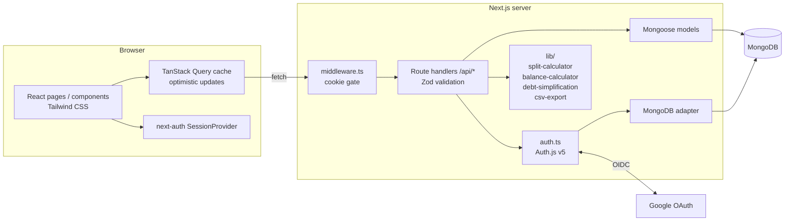
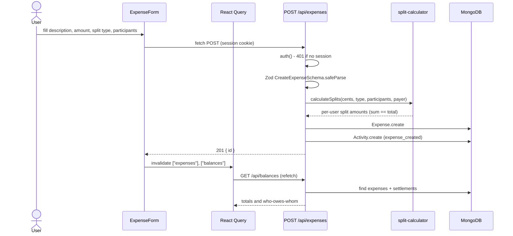
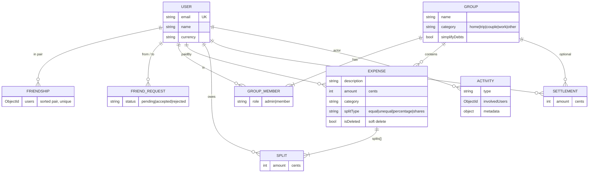

# Architecture

SplitEase is a single Next.js (App Router) application: React UI, REST-style route handlers and MongoDB persistence live in one deployable unit.

## System overview

## Layers

| Layer | Location | Responsibility |
|-------|----------|----------------|
| Pages | `src/app/(app)/*`, `src/app/(auth)/*` | Server-rendered shells and client pages (dashboard, friends, groups, expenses, settlements, activity, profile) |
| Components | `src/components/` | UI primitives (`ui/`), layout (Sidebar, Header, MobileNav), `ExpenseForm` |
| Hooks | `src/hooks/` | React Query hooks per resource; mutations apply optimistic updates and invalidate `expenses` / `balances` |
| API | `src/app/api/**/route.ts` | Auth check, Zod validation, DB access, activity logging |
| Domain logic | `src/lib/` | Pure functions: splits, balances, debt simplification, CSV |
| Persistence | `src/models/`, `src/lib/db.ts` | Mongoose schemas; cached connection for dev hot-reload and serverless |

## Main flow: adding an expense

## Data model

All money is stored as **integer cents** to avoid floating-point error.

`splits` and `members` are embedded subdocuments. Indexes cover the hot queries: `paidBy+date`, `groupId+date`, `splits.userId`, `involvedUsers+createdAt`.

## Authentication

- Auth.js v5 (`next-auth@5`) with the Google provider and the MongoDB adapter; sessions are stored in the database (`strategy: "database"`, 30-day expiry, refreshed daily).
- `session` callback copies `user.id` onto the session so handlers can scope queries.
- `src/middleware.ts` is a cheap cookie-presence gate: it redirects unauthenticated users away from app routes and logged-in users away from `/signin`. It does **not** validate the session; every API handler calls `auth()` itself and returns 401.
- `GET /api/demo-login` (only when `DEMO_MODE=true`) creates a session row for the seeded demo user and sets the session cookie, so reviewers can explore without Google credentials.
- Handlers only return data where the caller is a payer/participant/member.

## Balances and debt simplification

1. `calculateBalances` nets every expense split and settlement between each pair of users into a pairwise matrix.
2. For groups with `simplifyDebts`, `simplifyDebts` runs a greedy min-cash-flow pass: repeatedly match the largest creditor with the largest debtor, which reduces the number of payments needed to settle the group.
3. Remainder cents from non-divisible splits are assigned to the payer so splits always sum exactly to the total.

## Integrations

| Service | Use |
|---------|-----|
| MongoDB (Atlas or local) | Application data and auth sessions |
| Google OAuth | Sign-in; avatar images from `lh3.googleusercontent.com` (allowed in `next.config.ts`) |

## Configuration

See `.env.local.example`: `MONGODB_URI`, `AUTH_SECRET`/`NEXTAUTH_SECRET`, `GOOGLE_CLIENT_ID`, `GOOGLE_CLIENT_SECRET`, `NEXTAUTH_URL`, `AUTH_TRUST_HOST`.

## Deployment

Designed for Vercel: serverless route handlers plus MongoDB Atlas. `lib/db.ts` caches the Mongoose connection on `global` so warm invocations and dev hot reloads reuse one connection. Set the env vars in the project settings, add the production callback URL (`/api/auth/callback/google`) to the Google OAuth client, and allow the host in the Atlas network list.

## Key design decisions

- **Integer cents everywhere** - no float drift; format only at the edge (`formatCents`).
- **Pure domain logic in `lib/`** - split, balance and simplification code has no I/O and is unit-tested.
- **Soft-delete expenses** (`isDeleted`) so history and the activity log stay consistent.
- **Activity log as its own collection** with `involvedUsers`, so feeds are a single indexed query.
- **Client cache with 5-minute staleTime** plus explicit invalidation after mutations; deletes are optimistic with rollback.
- **Database sessions over JWT** so sessions can be revoked server-side.
